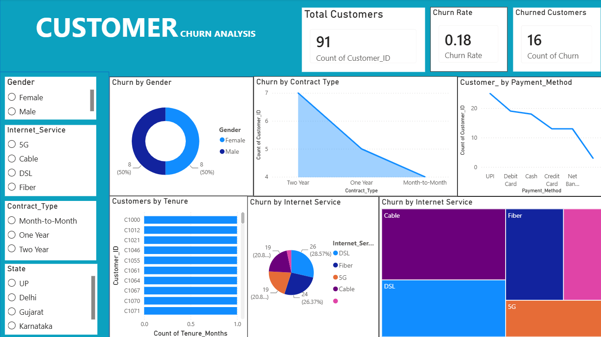

# 📊 Customer Churn Analysis

## 📌 Project Overview

Customer Churn Analysis is a data analytics project focused on understanding customer behavior and identifying patterns associated with customer churn. Python is used for data preparation, and Microsoft Power BI is used to build an interactive dashboard.

The project aims to turn customer data into meaningful insights that can support better customer retention decisions.

## 🎯 Project Objectives

- Analyze customer churn patterns.
- Explore customer demographics and subscription behavior.
- Examine churn across contract types and internet services.
- Analyze customer tenure and payment methods.
- Build an interactive Power BI dashboard.
- Support data-driven decision-making through visualizations.

## 🛠️ Tools & Technologies

- Python
- Pandas
- Microsoft Power BI
- Data Cleaning
- Data Visualization
- Exploratory Data Analysis (EDA)

## 📂 Project Files

- [Python Notebook](./Cleaned%20data.ipynb)
- [Power BI Dashboard](./Customer_Churn_Analysis.pbix)
- [Dashboard Screenshot](./Dashboard.png.png)

*Note: Make sure these filenames exactly match the files uploaded to your repository.*

## 📈 Dashboard Preview

## 📊 Dashboard Features

- Total Customers
- Churned Customers
- Churn Rate
- Churn by Gender
- Churn by Contract Type
- Churn by Internet Service
- Customers by Tenure
- Monthly Charges by Churn
- Customers by Payment Method
- Interactive slicers for Gender, Contract Type, State, and Internet Service

## 🔍 Analysis Highlights

The dashboard helps explore customer churn across different customer groups, contract types, internet services, tenure, and payment methods.

These visualizations can help identify patterns and customer segments that may need further investigation.

## 💡 Skills Demonstrated

- Data Cleaning and Preparation
- Python Data Analysis
- Exploratory Data Analysis
- Data Visualization
- KPI Development
- Power BI Dashboard Design
- Interactive Reporting

## 🚀 How to Use

1. Download or clone this repository.
2. Open the Python file in a compatible Python environment.
3. Install the required Python libraries, if needed.
4. Open the .pbix file using Microsoft Power BI Desktop.
5. Connect the report to the appropriate dataset if prompted.
6. Explore the dashboard using the charts and slicers.

## 🔮 Future Improvements

- Investigate key factors associated with customer churn.
- Develop customer retention recommendations.
- Add more detailed customer segmentation.
- Explore predictive churn analysis using machine learning.

## 👩‍💻 Author

**Divya Gupta**

## 🔗 Connect With Me

- [LinkedIn](www.linkedin.com/in/divya-gupta-803a14295)
- ## 🔗 Project Repository

[View Project on GitHub](https://github.com/DIVYA-14a/Customer-Churn-Analysis)

## ⚠️ Disclaimer

This project was developed for educational and analytical purposes. Ensure that any publicly shared dataset contains no private or confidential customer information.

